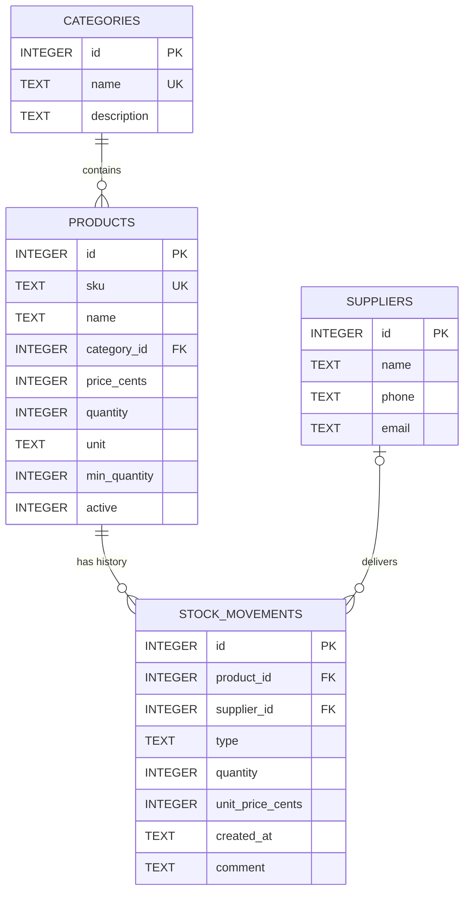

# Database Documentation

Author: <your name>, responsible for the data layer (models, repositories, database)

## 1. Overview

The application stores its data in a **SQLite** database. I chose SQLite because the whole database is a single file, so nobody on the team has to install or configure a database server, and the project starts with one command on any machine. Access goes through plain **JDBC** (driver: `sqlite-jdbc`), wrapped in the Repository pattern, so the rest of the application never sees SQL.

The schema lives in [`src/main/resources/schema.sql`](../src/main/resources/schema.sql). It uses `CREATE TABLE IF NOT EXISTS`, so it can safely be executed on every application start.

## 2. Entity-relationship diagram



## 3. How I structured the data

I split the data into three kinds of tables, because each kind behaves differently:

| Kind | Tables | Behaviour |
|---|---|---|
| Reference tables | `categories`, `suppliers` | small, rarely changed, referenced by other tables |
| Master data | `products` | the catalogue: the current state of every product |
| Fact table (journal) | `stock_movements` | the history: every incoming and outgoing movement; it only grows |

The application reads the `products` table most often (lists, search), while `stock_movements` grows the most and is the basis for reports and statistics.

## 4. Tables

### categories
Groups products (for example "Electronics"). The name is `UNIQUE` so the same category cannot exist twice.

### suppliers
Companies that deliver goods. Phone and e-mail are optional. The phone is stored as `TEXT` because it can contain `+`, spaces and leading zeros.

### products

| Column | Purpose |
|---|---|
| `id` | technical identifier, used by foreign keys; it never changes |
| `sku` | article number used by people, `UNIQUE` |
| `name` | product name |
| `category_id` | reference to `categories.id` |
| `price_cents` | current price as integer cents |
| `quantity` | current stock |
| `unit` | unit of measure (`pcs`, `kg`, `pack`), without it a quantity has no meaning |
| `min_quantity` | threshold for the "low stock" warning |
| `active` | `1` = visible, `0` = "deleted" (soft delete) |

### stock_movements

| Column | Purpose |
|---|---|
| `id` | identifier of the journal entry |
| `product_id` | which product was moved |
| `supplier_id` | which supplier delivered it (`NULL` if none) |
| `type` | `IN` (incoming) or `OUT` (outgoing) |
| `quantity` | how many units, always positive |
| `unit_price_cents` | price per unit at the moment of the movement |
| `created_at` | date and time, ISO-8601 text |
| `comment` | optional note |

## 5. Design decisions and why I made them

**Every table has its own `id` (primary key, `AUTOINCREMENT`).**
Names and articles can change, but other tables must keep pointing at the same row. `AUTOINCREMENT` guarantees that an id of a deleted row is never reused, so old journal entries can never end up pointing at a new, unrelated row.

**Foreign keys (`REFERENCES`) instead of copying names.**
A product stores `category_id`, not the category name. A category can be renamed in one place, there are no typos or duplicates, and the database refuses to reference a category that does not exist or to delete a category that is still in use.
SQLite disables foreign keys by default, so `PRAGMA foreign_keys = ON` is executed on every new connection.

**Prices are stored as integer cents.**
Floating point numbers cannot represent most decimal fractions exactly (`0.1 + 0.2` is `0.30000000000000004`), which is unacceptable for money. In the database a price of 19.90 EUR is stored as `1990`; in Java it is a `BigDecimal`. The repository layer converts between the two.

**The current stock is stored in `products.quantity` and also derived from the journal.**
I could have calculated the stock as the sum of all movements, but then every product list would have to scan the whole journal. Instead I keep the current stock in the product row for fast reads, and I keep the journal for the history. To keep both consistent:
1. A new product always starts with stock 0. Stock changes only through movements.
2. Updating the stock and inserting the journal entry happen **in one transaction**: either both succeed or both are rolled back.
3. A consistency query (see section 7) proves that stored stock equals the sum of movements.

**The journal is append-only.**
Entries are never edited or deleted, because it is the history of the warehouse. A mistake is corrected with a new compensating movement.

**Each movement stores the unit price at that moment.**
Product prices change over time. If the journal only referred to the current price, a report like "value of goods sold in October" would silently change when the price changes. The movement is a snapshot of the past, so it must carry its own price.

**`quantity` is always positive; the direction is defined by `type`.**
This avoids ambiguous cases such as "incoming -5" or "outgoing -5".

**A supplier is only allowed for incoming goods.**
Enforced by a table-level `CHECK (supplier_id IS NULL OR type = 'IN')`.

**Products are deleted "softly" with the `active` flag.**
A product has movement history. Physically deleting the row would break the journal (and the foreign key would refuse it anyway). A deactivated product disappears from the lists, but its history stays intact. SQLite has no boolean type, so `0` and `1` are used, restricted by a `CHECK`.

**Dates are stored as ISO-8601 text (`2026-10-22T12:36:00`).**
Such strings sort correctly as plain text, and Java maps them directly to `LocalDateTime`.

**Two lines of defence.**
The service layer validates everything first and shows a clear message to the user. The database constraints (`NOT NULL`, `UNIQUE`, `CHECK`, `REFERENCES`) are the last barrier in case a bug slips through. For example, the stock can never become negative even if the service has an error.

**Indexes** on `products(name)`, `products(category_id)`, `stock_movements(product_id)` and `stock_movements(created_at)`. They speed up searching by name, filtering by category, showing the history of one product, and date-based reports. `UNIQUE` columns already get an index automatically. For the expected data volume the difference is small, but it is good practice and costs nothing.

## 6. Mapping between Java and SQL

| Java | SQL | Conversion |
|---|---|---|
| `Long id` | `INTEGER` | `null` until the row is saved; the generated id is read after `INSERT` |
| `BigDecimal` price | `INTEGER` cents | `price.movePointRight(2).longValueExact()` / `BigDecimal.valueOf(cents, 2)` |
| `MovementType` enum | `TEXT` (`'IN'` / `'OUT'`) | `type.name()` / `MovementType.valueOf(text)` |
| `LocalDateTime` | `TEXT` (ISO-8601) | `toString()` / `LocalDateTime.parse(text)` |
| `boolean active` | `INTEGER` (`0` / `1`) | `active ? 1 : 0` / `value == 1` |
| `Category` inside `Product` | `category_id` | loaded with a `JOIN` in the repository |

## 7. Consistency check

This query returns every product whose stored stock differs from the sum of its movements. It must return no rows, so I use it as an integration test.

```sql
SELECT p.id, p.sku,
       p.quantity AS stored,
       COALESCE(SUM(CASE m.type WHEN 'IN' THEN m.quantity ELSE -m.quantity END), 0) AS calculated
FROM products p
LEFT JOIN stock_movements m ON m.product_id = p.id
GROUP BY p.id
HAVING stored <> calculated;
```

## 8. Possible future improvements

- A third movement type `ADJUSTMENT` for inventory corrections after a physical stock count.
- Soft delete for categories and suppliers.
- A separate purchase price and selling price for products.
- Users and roles, with the user stored on each journal entry.